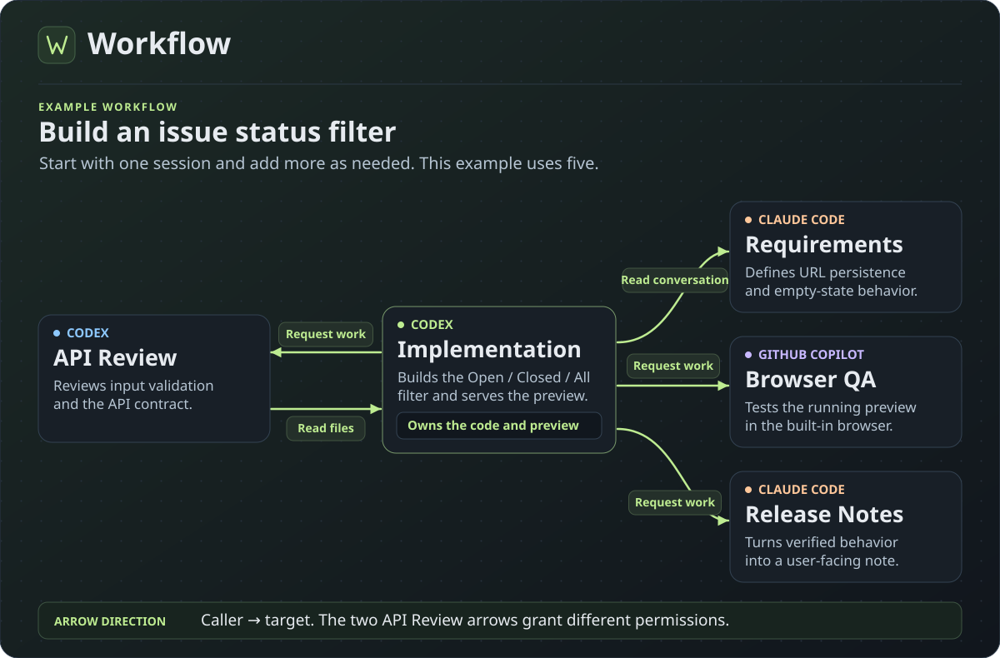
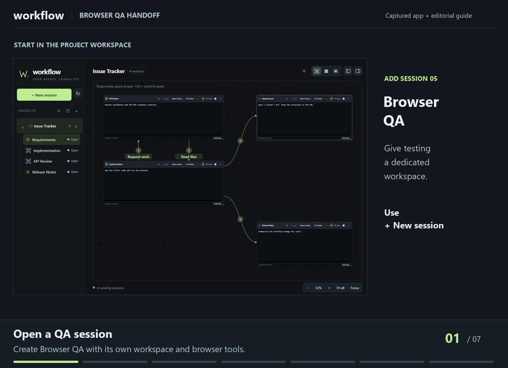
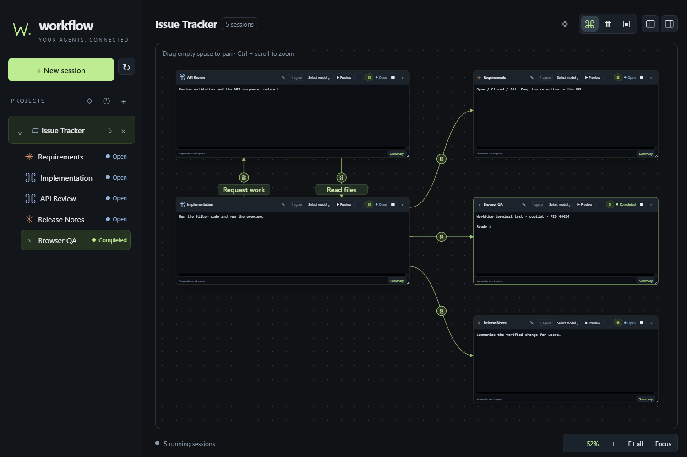
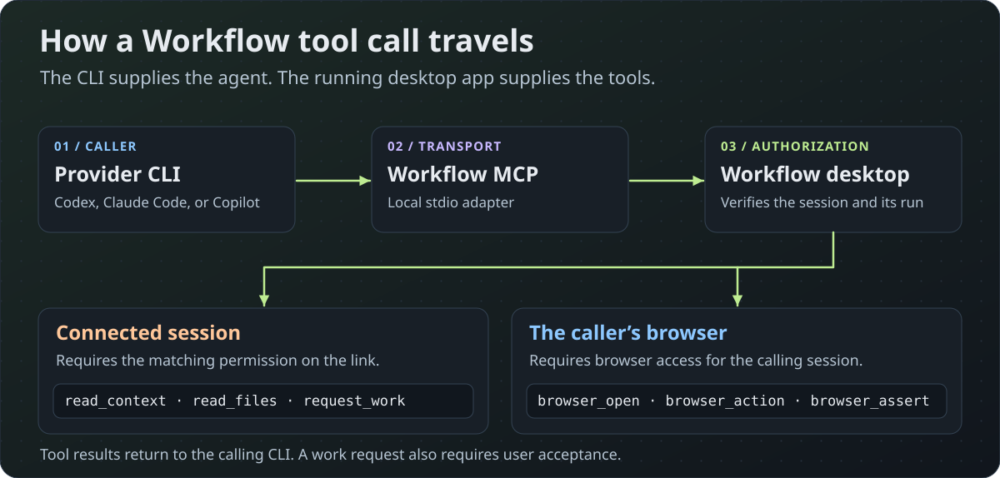
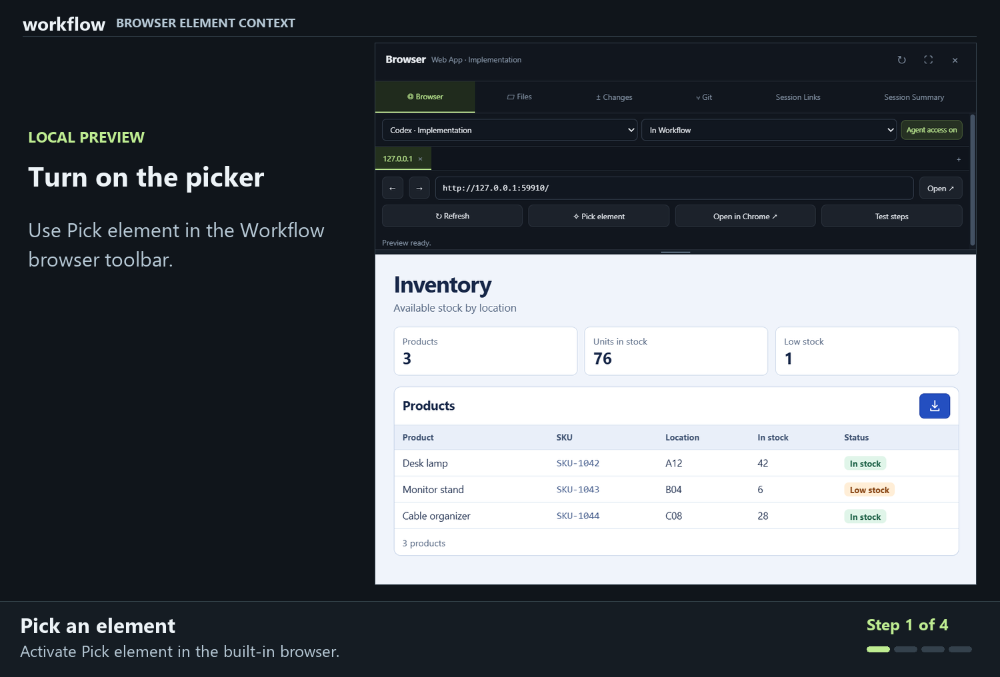
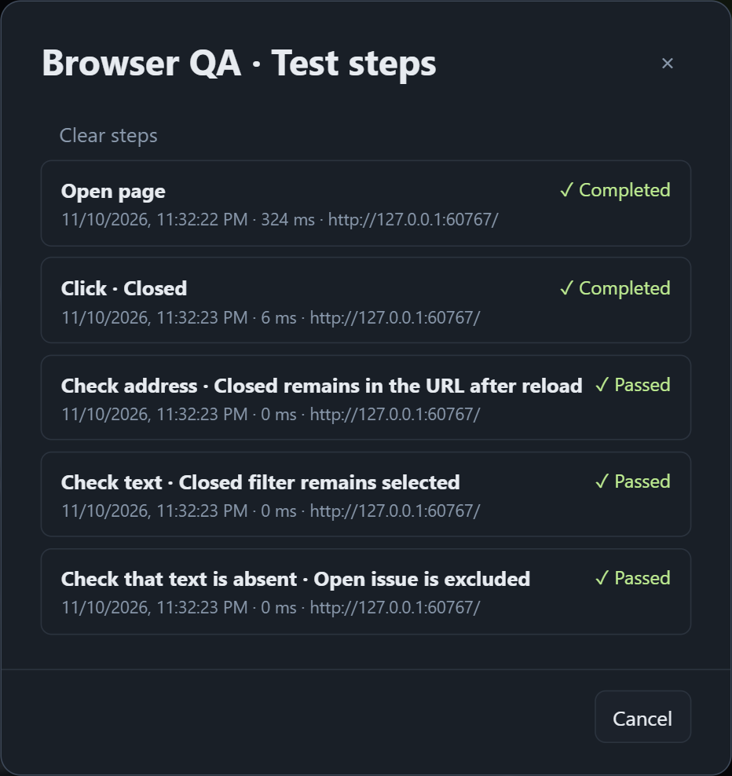
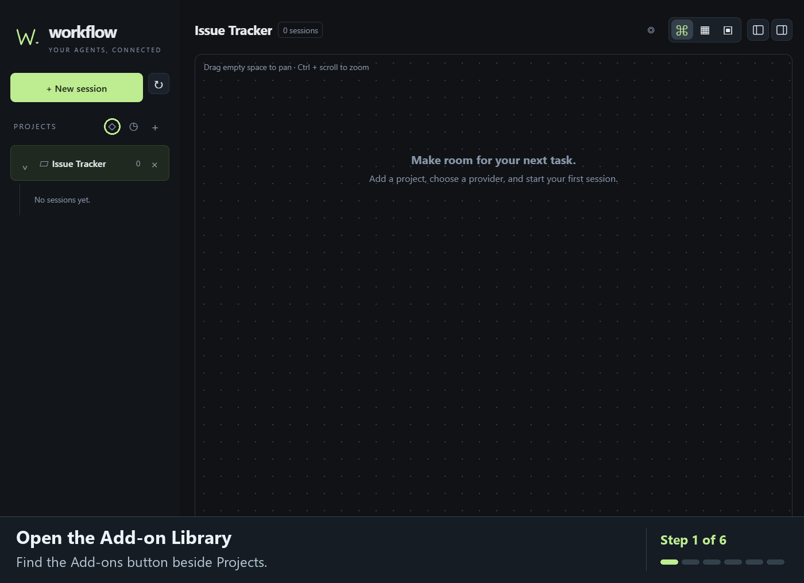

# Workflow

Workflow is a Windows desktop workspace for Codex, Claude Code, and GitHub Copilot CLI. Arrange their terminals on a map, draw links that grant specific access, and follow the work from a conversation to a browser check and a code review.

Start with one session and add more as needed. This example uses five.



[Session links](#share-context-across-sessions) · [Workflow MCP](#how-workflow-mcp-works) · [Browser testing](#from-local-preview-to-browser-evidence) · [Add-ons](#use-add-ons-in-selected-sessions) · [Quick start](#quick-start)

## Share context across sessions

The example adds an **Open / Closed / All** filter to a local issue tracker. The selected status should survive a reload through the URL, and the API should reject invalid status values. Implementation owns the code and serves the preview from its workspace. The other four sessions contribute requirements, findings, test evidence, or release notes.

| Session | Role | Outgoing link |
| --- | --- | --- |
| **Requirements** · Claude Code | Defines acceptance criteria and edge cases, including URL persistence and empty results. | — |
| **Implementation** · Codex | Builds the filter and API, starts the preview, and applies fixes from review. | Read the **Requirements** conversation. Request work from **API Review**, **Browser QA**, and **Release Notes**. |
| **API Review** · Codex | Reads the changed endpoint and returns findings about validation and the response contract. | **Implementation** · Read files |
| **Browser QA** · GitHub Copilot | Opens Implementation's preview in the built-in browser and reports the results. | — |
| **Release Notes** · Claude Code | Drafts a user-facing note from the verified behavior supplied in the request. | — |

The API review uses two links. Implementation can request a review, and API Review can read the files it needs through a separate link in the opposite direction. Browser QA gets the preview address and test steps in its work request. Release Notes gets the verified behavior in its own request.

On the map, drag from the calling session's link icon to the session it should access. Choose permissions when saving the link. The arrow points **from the caller to the session it can access**. Click the link icon on the line to inspect its permissions.

### Watch the browser QA handoff

The animation follows the five-session example as Implementation grants **Request work** to Browser QA through one link. Browser QA submits the accepted request, checks the filter in the built-in browser, and returns the result through that same request.



*Recorded in Workflow against a local demo with sample terminal output. The walkthrough adds a permission guide and close-ups to the app capture.*

<details>
<summary>See the five-session workspace</summary>



*Workflow running a local demo with sample terminal output. Arrow routing and permission labels are arranged for this capture.*

</details>

## How Workflow MCP works

When session tools are enabled, Workflow configures the provider CLI to use its local Model Context Protocol (MCP) server. The CLI calls a stdio adapter, which forwards the request to the running desktop app over a loopback connection. Workflow checks the calling session and its current run before handling the call. Connected-session permissions and browser access are checked separately.



| What the agent needs | Workflow tools | Access |
| --- | --- | --- |
| Find connected sessions | `session_catalog` | Lists the caller's explicit links |
| Read a conversation | `read_context` | Read conversation permission on the target link |
| Inspect changed files or read selected files | `read_files` | Read files permission on the target link |
| Ask for work and exchange results | `request_work`, `report_result`, `read_result` | Request work permission and user acceptance |
| Use a browser and record checks | `browser_open`, `browser_read`, `browser_action`, `browser_assert` | Browser access for the calling session |

A work request goes to an existing session. When you accept it in Workflow, it becomes a draft in that session's terminal. You submit the draft, and the receiving agent can report the outcome for the originating session to read.

## From local preview to browser evidence

**Launch the project from its session.** Save a PowerShell command and a local URL on the session card. **Preview** runs the command in that session's workspace and opens the built-in browser after verifying that the server is ready. If the port is already in use, Workflow tells you before launching.

### Send a prompt about a selected element

In the built-in browser, turn on **Pick element** and hover over the inventory page’s download icon. Workflow outlines the button and shows its selector, `button#export-csv`. Click the highlighted button, then choose **Add to prompt** to attach references to its HTML, styles, and screenshot. Add your request in the terminal and press **Enter** to send it.

> Add a visible “Export CSV” label next to the download icon.



*Recorded in Workflow with sample inventory data and a test terminal. The close-up shows the picker’s highlight and selector. The prompt excerpt shows the request and attachment filenames.*

### Record a browser check

**Ask the agent to verify what happens.** Browser QA can open the preview URL in its own session, select **Closed**, reload the page, and check both the URL and the visible results. Open **Test steps** to inspect the recorded actions and passed or failed checks. Workflow can capture a screenshot when a check fails.

For checks in Chrome, Workflow can open a tab in a dedicated Chrome profile.

> Open the preview in the built-in browser and select Closed. Reload the page. Verify that the URL still contains `status=closed`, the page shows closed issues, and open issues are excluded.



*The trace displays the base address for privacy. The browser address bar in the walkthrough shows the full filter URL.*

## Review the work before you merge

| Surface | What you can review or change |
| --- | --- |
| **Session Summary** | Files changed since the session started, line diffs, linked sessions, and browser verification |
| **Files and Changes** | Edit supported text files, inspect diffs, revert selected lines, or transfer selected changes from an isolated workspace back to the project |
| **Git** | Stage and commit selected files, see the branch graph, compare two commits, and resolve merge conflicts |
| **Providers** | Choose a CLI account per session and view the usage limits each provider reports |
| **Add-ons** | Install supported skill packages from the Add-on Library and enable them per isolated session. The current catalog includes [OpenSpec](https://github.com/Fission-AI/OpenSpec) and [Ponytail](https://github.com/DietrichGebert/ponytail). |

Choose **Current folder and branch** to work directly in the project. Choose **Separate workspace** to work in a Git worktree when the project has an initial commit, or a folder copy otherwise. Workflow also supports projects without Git.

## Use add-ons in selected sessions

Open the **Add-on library** beside **Projects** and install a package. In **New session**, choose **Separate workspace**, check the add-ons you want, and select **Start session**. Installed add-ons are unchecked by default in each new session.



*Recorded in Workflow with a local demo project and a test terminal.*

## Quick start

1. Download `Workflow-Windows-x64.zip` from the repository's **Releases** page.
2. Extract the archive and launch `Workflow.exe`.
3. Open **Providers** to find your CLI, select its executable, or sign in.
4. Add a project folder or clone a repository, then start a session. The interface language is available in **Settings**.

**Requirements:** Windows 10 or 11 (x64), Microsoft Edge WebView2 Runtime, and the CLI and account for each provider you use. Git enables Git operations, Google Chrome enables Chrome mode, and GitHub CLI enables draft pull requests. Provider CLIs and add-ons can have additional requirements. Workflow itself ships as a Rust/Tauri executable with bundled frontend assets.

## Local data and session lifetime

Workflow stores projects, session metadata, terminal output, layout, and conversation IDs locally. Closing the app stops its terminals and preview servers. Reopening restores the workspace, and the play button on a session card resumes a verified conversation. The default profile is `%LOCALAPPDATA%\local.workflow.desktop`. Set `WORKFLOW_DATA_DIR` before launch to use a separate profile.

## Build and test

Install the Rust toolchain pinned in `rust-toolchain.toml`, the MSVC build tools, and the Windows SDK. From the project root:

```powershell
.\Build.cmd
cargo test --locked
.\scripts\package.ps1
```

The packaging script produces `dist/Workflow-Windows-x64.zip` and a SHA-256 checksum. The integration suite in `tests/integration.cjs` uses Playwright Core and a temporary data profile to exercise Windows terminals, Git, browser actions, previews, and shutdown. Set `WORKFLOW_TEST_EXE` to the executable to test and `WORKFLOW_PLAYWRIGHT` to the Playwright Core module path if installed outside the repository.

## License

Workflow is available under the [MIT License](LICENSE). See the [third-party notices](THIRD-PARTY-NOTICES.txt) for dependency licenses and attributions.

